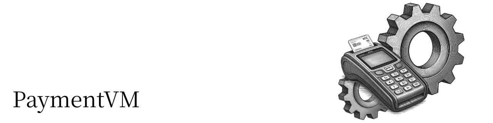

## PaymentVM

<p align="center">
  
</p>

`PaymentVM` /ˈpeɪməntˌviːˈɛm/ — A Virtual Machine for Programmable Payment

> Inspired by J.P. Morgan Kinexys' framework on programmable payments, as detailed in [*Application of Programmability to Commercial Banking and Payments*](https://www.jpmorgan.com/kinexys/documents/Application-of-Programmability-to-Commercial-Banking-and-Payments.pdf).

> [!WARNING]
> **Under Development:** This repository is in an early alpha state and is not recommended for production use.


## Install

Install via `npm`

``` shell
$ npm install @open-pm/paymentvm
```

Install via `forge`

``` shell
$ forge install open-pm/paymentvm
```

## Usage

Configuration `hardhat`

``` text
solidity: {
  version: "0.8.37",
  settings: {
    viaIR: true,
    optimizer: {
      enabled: true,
      runs: 200,
    },
  },
}
```

Configuration `forge`

``` toml
[profile.default]
solc_version = "0.8.37"
via_ir = true
optimizer = true
optimizer_runs = 200 # default
```

Import to project

``` solidity
import { VM } from "@open-pm/paymentvm/core/VM.sol";
```

Example snippet
``` solidity
// SPDX-License-Identifier: CC0-1.0
pragma solidity 0.8.37;

import { VM } from "@open-pm/paymentvm/core/VM.sol";

contract MyPayment {
    // TODO
}
```

## Build

### Install

```
curl -L https://foundry.paradigm.xyz | bash
foundryup --install $(cat .foundry-version)
```

### Build

```shell
$ forge build
```

### Test

```shell
$ forge test
```

## Copyright

For detailed copyright attribution. See [COPYRIGHT](./COPYRIGHT).

## License

PaymentVM is licensed under Apache-2.0. See [LICENSE](./LICENSE).
